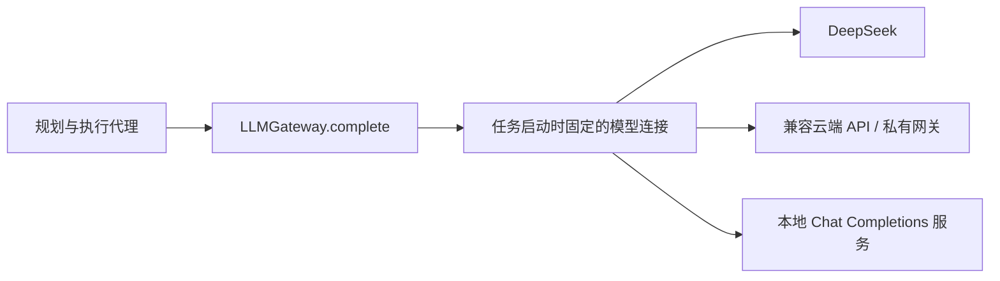
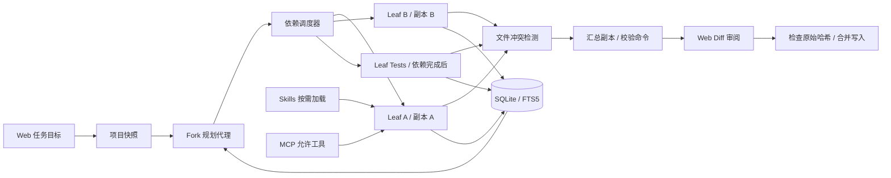

# XCode · 多智能体 Coding Agent

一个面向本地代码仓库的多智能体 Coding Agent，以 Agent Loop、Tool Calling、Skills、Memory 和上下文管理为核心，支持从自然语言目标到代码检索、文件修改与测试验证的连续执行。Web 工作台提供执行跟踪、代码差异审阅和人工合并入口。后端使用 Python 标准库，前端使用 HTML / CSS / JavaScript；无需安装运行时第三方包。

通过统一的 LLMGateway 接入 Chat Completions 兼容模型，默认保留 DeepSeek 连接。可在页面保存多组模型地址、标识和独立凭据，为每次任务选择模型；并行数、执行预算和命令权限仍可独立设置。

## 启动

需要 Python 3.11+，从本仓库目录运行：

```powershell
.\start.ps1
```

启动脚本优先使用此机器的 Codex Python 运行时；否则使用系统 Python / py。其他环境也可直接运行：

```bash
python -m xcode.server --port 8765
```

打开 <http://127.0.0.1:8765>。端口可用 `--port` 更改，服务只监听本机 IPv4 回环地址。不要将此开发服务器转发到公网。

1. 点击“运行离线演示”，验证不需要 Key 的完整闭环。固定脚本在独立的 `.xcode/demo-project/` 演示项目内生成代码、文档与测试，执行 3 个单元测试；再次运行时可观察前次记忆的召回。
2. 在“模型设置”中新增或编辑模型连接，填写连接名称、Base URL、服务端模型标识和该连接自己的 Key。默认 DeepSeek URL 为 `https://api.deepseek.com`，初始模型名为 `deepseek-chat`；模型标识以服务端实际提供为准。
3. 回到工作台，选择本次任务的模型（或跟随默认），输入已有项目的绝对路径和任务目标，启动任务。
4. 查看代理状态、事件记录、代码 diff 与验证输出，最后点击“合并到项目”。审阅前原项目不被写入。

也可在启动前设置环境变量：

```powershell
$env:DEEPSEEK_API_KEY = '<your-key>'
$env:DEEPSEEK_BASE_URL = 'https://api.deepseek.com'
$env:DEEPSEEK_MODEL = 'deepseek-chat'
.\start.ps1
```

运行中也可用 `python scripts/configure_key.py` 隐藏输入默认连接的 Key，或添加 `--model-profile-id <连接ID>` 指定连接。Key 不写入 settings.json，模型连接表单中 Key 留空会保留当前值，勾选清除才删除。重启后需重新输入或在该连接绑定环境变量名；旧 `DEEPSEEK_API_KEY` 仅绑定迁移生成的 DeepSeek 连接。`.env.example` 只演示变量名称；应用不会自动加载 `.env`。

## 模型网关与连接切换

LLMGateway 是应用内的统一模型调用层。Agent 的规划、工具循环和记忆管理依赖统一的 `complete()`，模型连接则封装实际地址、模型标识、认证与工具能力。当前适配 Chat Completions 兼容协议，支持 DeepSeek、兼容的云端服务、私有网关及本地服务；目标模型必须支持 Function Calling 才能运行编程任务。



- 在“模型设置”保存最多 12 组连接，可预填 DeepSeek、本地 Ollama 或自定义兼容接口模板，再填写服务端真实模型标识。Ollama 模板指向 `http://127.0.0.1:11434/v1`；应用不会安装或下载本地模型，模型的工具支持需自行确认。
- 每组连接独立保存内存 Key，也可显式绑定环境变量名；公共配置只返回 `has_api_key`。更换实际 Base URL 会解除旧 Key 和未重新确认的环境变量绑定，避免跨连接串用凭据；只修改模型名或 URL 末尾斜线不改变后端凭据绑定。
- 可设置默认连接，也可在工作台为本次任务指定连接。任务创建时固定地址、模型与 Key，后续切默认、编辑或删除连接不会改变已启动任务。历史任务保留实际模型名称与连接标识，旧历史则显示未记录。
- 本地服务若无需认证，可关闭“需要 API Key”；空 Key 时不发送 Authorization。未声明支持工具或缺少必要凭据的模型会在任务创建前被拒绝。

旧版单模型 `base_url` / `model` 会迁移为 DeepSeek 连接；旧 `/api/settings` 调用继续编辑默认连接。新增与更新连接使用 `POST /api/models`，设置默认使用 `POST /api/settings` 的 `default_model_id`，任务通过 `model_profile_id` 指定连接。该层保留有界重试、超时与取消；当前按用户选定连接执行，不会自动切换到另一模型。模型请求拒绝 HTTP 重定向，避免认证头随跳转发送到未配置的地址；遇到重定向请配置最终 API 地址。

## 工作链路

规划代理拆解任务职责与依赖关系，执行代理通过“模型推理 → 工具调用 → 结果观察 → 继续决策”循环完成工作。工具输出与异常回填到对话，作为后续操作的依据；Skills 按需加载，项目记忆在规划和执行时召回，上下文达到字符预算后压缩为历史摘录。执行结束后汇总文件差异和验证结果，交由用户审阅后合并。



| 能力 | 当前实现 |
| --- | --- |
| 多代理并行 | 一个 fork 规划代理生成依赖图；多个 leaf 执行代理通过 ThreadPoolExecutor 并行工作 |
| 依赖与预算 | 校验任务数、循环与未知依赖；最多 6 个并行代理、每个代理最多 40 轮；整体执行阶段预算 10 分钟 |
| 防止线程池饥饿 | 协调器在单独线程中调度；叶子代理没有派发子代理的工具，也不会占住线程等待子任务 |
| 活性与取消 | 协调器每 15 秒记录调度心跳；请求与命令均有超时；取消会在当前阻塞操作返回后收敛 |
| 修改隔离 | 每个代理持有文件快照副本；后续任务读取已完成依赖的变更 |
| 冲突检测 | 独立任务修改同一文件且内容不同即拒绝汇总；有依赖的后继任务可覆盖祖先结果；保守地按整个文件检测冲突 |
| 合并写入 | 审阅后逐个检查原文件 SHA-256；检测外部编辑；写入异常时恢复已触碰文件，单文件使用临时文件替换 |
| 长期记忆 | SQLite WAL，FTS5 trigram 中文与英文检索；短词 / 无 FTS5 时回退 LIKE；按项目隔离，预注入最近项目约定并召回相关历史；记录任务与代理来源 |
| 上下文压缩 | 超过字符预算时保留近期完整工具轮次，将历史工具与结果摘录写入摘要，原始记录存数据库 |
| Skills | 初始仅向模型展示名称和描述；通过 load_skill 按需读取全文；界面预览、启用/禁用；任务中展示实际加载记录；支持明确限定的 YAML frontmatter 子集 |
| Runtime Hooks | 通过可信 Python 模块注册生命周期回调；前置可拒绝操作，模型调用前可注入指引；后置观察结果，执行日志展示触发记录 |
| MCP | stdio JSON-lines / Streamable HTTP POST JSON 或 SSE；initialize、工具分页发现、tools/call；精确工具允许列表 |
| 模型接口 | 统一 LLMGateway，保存并切换多组 Chat Completions 连接；每任务固定模型与独立凭据；非流式 function calling，保留 reasoning_content；有界重试与取消 |
| Web 控制台 | 任务历史、执行代理、日志、diff、验证、技能与记忆使用记录、项目约定保存与删除、记忆原始记录、Skills 预览与开关、MCP 配置与发现、模型设置 |

`fork / leaf` 是应用自己的代理角色，不是 OS fork。第一版只开放一层规划派发，任务依赖链不单独限制深度，仍受最大子任务数约束；尚未开放递归 fork 派发。规划代理不接收执行工具，叶子代理不接收派发工具。ThreadPoolExecutor 用于并行网络请求和外部命令，不用于加速 Python CPU 密集工作。

## 校验命令

默认不执行来自项目的程序。在设置中填写**精确的参数数组**：

```json
[
  ["python", "-m", "unittest", "discover", "-s", "tests"]
]
```

Windows 上若 `python` 是商店占位程序，请把第一项改为真实 `python.exe` 的绝对路径。创建任务时勾选“运行设置中已授权的校验命令”。代理可调用这些精确命令，汇总阶段也会全部执行。无 shell；单条命令 60 秒超时；监控输出文件上限 2MB，展示前 12KB。校验失败或校验改动了代码文件时阻止合并。

文件副本不是操作系统级沙箱：授权的项目程序或 MCP 服务仍可能访问副本之外的资源，子程序创建的后代进程目前没有进程组级清理。因此只授权可信项目的命令 / MCP 工具，未来部署应加入容器或 OS 隔离。

## Skills

技能用于复用“怎样完成任务”的操作指引，记忆用于复用“这个项目已有哪些约定和历史结论”。启用技能只会把名称与说明加入 Agent 的能力目录；只有实际调用 `load_skill`，技能正文才会进入模型上下文。“技能与工具”可预览完整指引，工作台的“技能与记忆使用”区域记录每个代理真实加载的技能，区分可用目录与实际使用。

应用项目目录下放置 `skills/<name>/SKILL.md`，例如：

```markdown
---
name: python-quality
description: Python 实现与测试质量检查。
tools: [read_file, write_file, run_command]
enabled: true
---

先阅读关联模块，保持变更集中。补充边界与错误处理。
```

frontmatter 支持顶层字符串、布尔值、行内列表和 `|` / `>` 多行文本；不支持完整 YAML 语法 / 对象标签。`tools` 是技能描述元数据，不能扩大代理的实际权限。工具权限仍由角色、路径规则、命令允许列表与 MCP 允许列表决定。后端启动时 `--project` 指定的目录决定全局技能库与默认工作目录；每次任务的代码目录可另选。

## Agent Runtime Hooks

Skills 提供模型按需读取的操作指引；Hooks 由 Runtime 在指定生命周期节点自动触发，可用于执行固定检查、注入模型指引和观察执行结果。默认注册内置 `on_run_end / save_run_memory` 回调，优先级为 `100`：任务产生待审阅结果时，将结果保存到项目长期记忆；其他终态也会触发结束事件，但该内置回调不会写入成功记录。原有的待审阅结果保存逻辑迁入此回调，同一结果不会额外重复保存。

其他回调通过 `registry.register()` 显式注册，或在服务启动时指定可信的 Python 模块：

```bash
python -m xcode.server --port 8765 --hooks-module examples.hooks_example
```

示例模块 [examples/hooks_example.py](examples/hooks_example.py) 通过 `register_hooks(registry)` 注册三个回调：调用模型前加入“避免无关改动，完成后给出验证证据”；工具调用前拒绝 `delete_file`；任务结束后只打印任务 ID 与状态。拒绝删除工具仅限制该工具入口，仍需审阅文件内容变化；改写文件或已授权命令也可能删除内容。

| 事件 | 触发时机 | 回调能力 |
| --- | --- | --- |
| `on_run_start` | 任务开始执行时 | 可拒绝任务继续执行 |
| `before_model` | 规划或执行代理调用模型前 | 可拒绝调用，或加入 system 指引 |
| `after_model` | 模型成功返回后 | 观察返回结果 |
| `before_tool` | 工具执行前 | 可拒绝工具调用 |
| `after_tool` | 工具成功返回后 | 观察执行结果 |
| `on_tool_error` | 工具失败或被拒绝时 | 观察错误 |
| `on_run_end` | 任务进入结束状态时 | 观察任务状态 |

回调接收 `HookContext`，包含 `event`、`run_id`、`agent_id`、`workspace`、`mode` 和 `data`。上下文字段固定，`data` 为调用数据副本，修改它不会改写实际请求。模型事件的数据包含 `messages`、`tools`、`model_profile`、`step`、`source`；工具事件包含 `name`、`arguments`、`step`、`source`，执行后另含 `result` 或 `error`。模型配置不向回调传递 API Key，但消息、参数和结果可能含项目内容，回调应避免直接输出这些数据。

使用 `registry.register(event, handler, name="描述", priority=0)` 注册，数值较小的优先执行；返回 `None` 表示仅观察。前置回调可返回 `HookDecision(deny="拒绝原因")`，只有 `before_model` 可返回 `HookDecision(system_message="额外指引")`。单条指引最多 8,000 字符，单次模型调用累计最多 16,000 字符。后置回调只观察，异常会记录，不能改变已经完成的执行结果。工具原有的路径与授权校验仍会执行，Hook 不能授予额外权限。

每个任务开始时固定回调注册表。回调同步运行在触发事件的线程中，不同代理可能并发执行同一回调，因此需要线程安全并及时返回；当前不提供强制抢占 Python 回调的超时机制。工具回调覆盖真实模式、离线演示和汇总验证命令；人工合并、MCP 工具发现与服务清理不在工具回调范围。可在 Web 执行日志查看 Hook 触发记录，状态 API 提供已注册回调目录。

Hook 模块运行的是服务端 Python 代码，只应加载自己审阅过的模块。页面不提供上传或执行 Hook 代码的入口；未指定 `--hooks-module` 时保留原来的运行行为。

## 项目约定与跨任务记忆

在“长期记忆”页保存项目约定，例如“使用 unittest，测试文件放在 tests/”。项目路径应与任务工作目录相同。规划及每个执行代理启动前，自动注入同项目最近 3 条约定，再通过关键词检索补充最多 4 条相关历史，按 ID 去重；执行中仍可调用 `recall_memory` 按关键词检索。其他项目的记录不会注入该任务。项目约定是可复用的参考信息，不能扩大工具权限或覆盖当前用户任务。

记忆按项目约定、执行记录、上下文摘录、待审阅结果和合并结果分类，保留来源任务与代理。工作台展示实际召回的记录及新增记忆，记忆页提供关键词搜索、项目筛选和原始记录查看。用户可删除自己保存的项目约定，执行历史保留用于追溯。新增字段会在旧数据库上原位迁移，原记录与 ID 保留。

无需 API Key 即可观察复用：连续运行两次“离线演示”，第二次规划会检索到首次保存的计算器记录。演示使用固定的 `.xcode/demo-project/`，实际读取启用的 `python-quality` 技能并写入记忆；它是固定脚本，仅展示技能读取与记忆存取，不代表模型自主选用技能或生成代码。真实模式的技能使用记录只在模型成功调用 `load_skill` 后产生。

服务运行时，也可执行 `python scripts/verify_knowledge.py` 自动完成两次演示、保存一条演示项目约定，并验证第二次规划召回该约定与前次任务记录。脚本只操作隔离的演示项目，保留运行记录以便在工作台查看，不调用模型接口。

## MCP 配置

stdio：

```json
[
  {
    "name": "local",
    "transport": "stdio",
    "command": ["python", "D:/tools/my_mcp_server.py"],
    "allowed_tools": ["search"],
    "enabled": true
  }
]
```

Streamable HTTP：

```json
[
  {
    "name": "remote",
    "transport": "http",
    "url": "http://127.0.0.1:9000/mcp",
    "bearer_env": "MY_MCP_TOKEN",
    "allowed_tools": ["search"],
    "enabled": true
  }
]
```

在“技能与工具”保存，再点击“检测工具列表”；确认服务实际工具名后更新 allowed_tools。空允许列表不会启动服务或暴露工具。stdio 工具调用在同一服务上串行化，避免 JSON-RPC 响应串线；各代理的模型请求仍能并发。stdio 服务的 cwd 是初始项目快照，MCP 外部副作用不参与代码 diff 跟踪，应优先接入只读工具。

支持的 MCP 子集不包含 OAuth、旧 HTTP+SSE 传输、sampling、服务端反向请求与可恢复 SSE 流。协议初始化版本为 `2025-06-18`，后续请求带协商版本与会话 ID。

## 数据与边界

数据默认在 `.xcode/`：`settings.json`（无 API Key）、`memory.sqlite3`（摘要、原始记录、运行状态）、`runs/<id>/`（初始快照、代理副本与汇总副本）。原始记录可能包含项目代码。重启后历史可检索；未完成任务标记为中断，无法续跑。历史运行与项目副本暂时不自动清理。

快照排除 `.git`、`.env*`、常见密钥文件、依赖 / 构建 / 缓存目录和链接目录；这些过滤不能识别任意文件中硬编码的秘密。真实模式会将任务文本、选中的代码片段、记忆与工具输出发往配置的模型服务；离线演示不发送模型请求。

第一版快照限制为 800 个文件、总计 24MB、每个文件 1MB。当前只支持 UTF-8 文本修改，二进制变更会失败；未改动的二进制文件可以保留在副本。为了便于调试，同一服务一次只运行一个任务，但任务内可有多个代理。无认证、多用户权限、容器隔离、嵌入向量检索、自动冲突修复、Git 分支 / PR 提交或大仓库按需快照。

合并时的内部锁防止本应用的多次写入竞态；它不是外部编辑器文件锁，也不是跨文件数据库事务。断电 / 进程被强杀不能保证整批改动回滚。摘要为可观察的确定性摘录，仍可能丢失历史细节；需要时检索记忆或重新读取当前文件。参考简历中的性能提升数字没有被移植为本项目的测试结论。

## 开发与验证

项目新增 [20-task Benchmark 与自动 Evaluator](benchmarks/README.md)，覆盖代码理解、Bug 修复、功能实现、重构、测试编写，每类四题。用独立验收检查候选代码，并比较 Baseline / Context Manager / Prompt Guidance / Full Harness 四组，记录任务成功、模型轮次、工具调用及错误、已报告 Token 和耗时。

```powershell
.\scripts\benchmark.ps1 -Mode selfcheck
# 配置本机 DEEPSEEK_API_KEY 后才运行真实模型，会消耗模型额度：
.\scripts\benchmark.ps1 -Mode live -Tasks bugfix-01 -Variants baseline,full -MaxBatchTokens 40000
```

离线自检仅验证参考实现通过、初始缺陷被拒绝，不能当作 Agent 完成率。四组保持模型、权限与预算一致，只改变压缩和固定执行进度提示；当前没有学习型 Prompt Optimizer。未配置凭据时，`--live` 在网络调用前停止。完整设计、运行参数和指标口径见上述文档。

```bash
python -m unittest discover -s tests -v
node --check xcode/static/app.js
```

后端测试覆盖真实离线闭环、线程并发、依赖继承、失败阻断、工具循环模拟、取消、路径越界、大小写保护、stale hash、写失败回滚、中文记忆、上下文压缩、Key 不持久化、MCP stdio 握手与调用。`scripts/smoke_test.py` 通过本地 HTTP API 在 `.xcode/smoke-projects/` 创建独立项目并调用真实模型（会消耗模型额度），只在明确需要联网验证时运行。

```text
xcode/
  config.py       公共设置 / 内存凭据
  provider.py     LLMGateway / Chat Completions 兼容传输
  engine.py       规划、依赖调度、代理循环、压缩、冲突、验证
  workspace.py    路径规则、快照、diff、审阅后合并
  tools.py        内置工具与命令执行
  hooks.py        生命周期回调注册、决策与触发
  memory.py       SQLite / FTS5 长期记忆
  skills.py       frontmatter 与按需技能加载
  mcp.py          MCP 客户端
  server.py       回环 HTTP API
  static/         Web 控制台
skills/           示例技能
examples/         可信 Hook 模块示例
tests/            后端测试
scripts/          隐藏 Key 配置、真实模型验证
```

相关协议说明：[DeepSeek API 文档](https://api-docs.deepseek.com/)、[MCP transports](https://modelcontextprotocol.io/specification/2025-06-18/basic/transports)、[SQLite FTS5](https://sqlite.org/fts5.html)。
