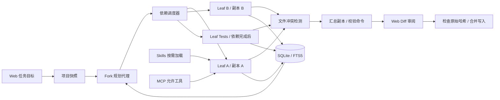

# XCode · 多智能体 Coding Agent

一个可运行的本地 Web 编程工作台，按照参考简历中的三个方向构建：并行协作、长期记忆、Skills / MCP。后端使用 Python 标准库，前端使用 HTML / CSS / JavaScript；无需安装运行时第三方包。

默认使用 DeepSeek 的 OpenAI 兼容 Chat Completions 接口。模型名、Base URL、并行数、执行预算和命令权限均可在界面设置。

## 启动

需要 Python 3.11+，从本仓库目录运行：

```powershell
.\start.ps1
```

启动脚本优先使用此机器的 Codex Python 运行时；否则使用系统 Python / py。其他环境也可直接运行：

```bash
python -m xcode.server --port 8765
```

打开 <http://127.0.0.1:8765>。端口可用 `--port` 更改，服务只监听本机 IPv4 回环地址。不要将此开发服务器转发到公网。

1. 点击“运行离线演示”，验证不需要 Key 的完整闭环。演示在 `.xcode/demo-projects/` 创建独立项目，由真实线程生成代码、文档与测试，执行 3 个单元测试。
2. “模型设置”中配置 Base URL、模型名称与 DeepSeek Key。默认 URL 为 `https://api.deepseek.com`，初始模型名为 `deepseek-chat`；如服务端模型命名有变化，在此修改。
3. 回到工作台，输入已有项目的绝对路径和任务目标，启动任务。
4. 查看代理状态、事件记录、代码 diff 与验证输出，最后点击“合并到项目”。审阅前原项目不被写入。

也可在启动前设置环境变量：

```powershell
$env:DEEPSEEK_API_KEY = '<your-key>'
$env:DEEPSEEK_BASE_URL = 'https://api.deepseek.com'
$env:DEEPSEEK_MODEL = 'deepseek-chat'
.\start.ps1
```

运行中也可用 `python scripts/configure_key.py` 隐藏输入 Key。Key 不写入 settings.json，界面中的 Key 留空会保留当前值，勾选清除才删除。重启后需重新输入或通过环境变量传入。`.env.example` 只演示变量名称；应用不会自动加载 `.env`。

## 工作链路



| 能力 | 当前实现 |
| --- | --- |
| 多代理并行 | 一个 fork 规划代理生成依赖图；多个 leaf 执行代理通过 ThreadPoolExecutor 并行工作 |
| 依赖与预算 | 校验任务数、依赖深度、循环与未知依赖；最多 6 个并行代理、每个代理最多 40 轮；整体执行阶段预算 10 分钟 |
| 防止线程池饥饿 | 协调器在单独线程中调度；叶子代理没有派发子代理的工具，也不会占住线程等待子任务 |
| 活性与取消 | 协调器每 15 秒记录调度心跳；请求与命令均有超时；取消会在当前阻塞操作返回后收敛 |
| 修改隔离 | 每个代理持有文件快照副本；后续任务读取已完成依赖的变更 |
| 冲突检测 | 独立任务修改同一文件且内容不同即拒绝汇总；有依赖的后继任务可覆盖祖先结果；保守地按整个文件检测冲突 |
| 合并写入 | 审阅后逐个检查原文件 SHA-256；检测外部编辑；写入异常时恢复已触碰文件，单文件使用临时文件替换 |
| 长期记忆 | SQLite WAL，FTS5 trigram 中文与英文检索；短词 / 无 FTS5 时回退 LIKE；按项目隔离模型注入 |
| 上下文压缩 | 超过字符预算时保留近期完整工具轮次，将历史工具与结果摘录写入摘要，原始记录存数据库 |
| Skills | 仅向模型展示名称和描述；通过 load_skill 按需读取全文；界面启用/禁用；支持明确限定的 YAML frontmatter 子集 |
| MCP | stdio JSON-lines / Streamable HTTP POST JSON 或 SSE；initialize、工具分页发现、tools/call；精确工具允许列表 |
| 模型接口 | DeepSeek / 兼容 Chat Completions；非流式 function calling；保留 reasoning_content；有界重试与取消 |
| Web 控制台 | 任务历史、执行代理、日志、diff、验证、记忆全文、Skills 开关、MCP 配置与发现、模型设置 |

`fork / leaf` 是应用自己的代理角色，不是 OS fork。第一版只开放一层规划派发，`max_depth` 限制的是任务依赖链深度；尚未开放递归 fork 派发。规划代理不接收执行工具，叶子代理不接收派发工具。ThreadPoolExecutor 用于并行网络请求和外部命令，不用于加速 Python CPU 密集工作。

## 校验命令

默认不执行来自项目的程序。在设置中填写**精确的参数数组**：

```json
[
  ["python", "-m", "unittest", "discover", "-s", "tests"]
]
```

Windows 上若 `python` 是商店占位程序，请把第一项改为真实 `python.exe` 的绝对路径。创建任务时勾选“运行设置中已授权的校验命令”。代理可调用这些精确命令，汇总阶段也会全部执行。无 shell；单条命令 60 秒超时；监控输出文件上限 2MB，展示前 12KB。校验失败或校验改动了代码文件时阻止合并。

文件副本不是操作系统级沙箱：授权的项目程序或 MCP 服务仍可能访问副本之外的资源，子程序创建的后代进程目前没有进程组级清理。因此只授权可信项目的命令 / MCP 工具，未来部署应加入容器或 OS 隔离。

## Skills

应用项目目录下放置 `skills/<name>/SKILL.md`，例如：

```markdown
---
name: python-quality
description: Python 实现与测试质量检查。
tools: [read_file, write_file, run_command]
enabled: true
---

先阅读关联模块，保持变更集中。补充边界与错误处理。
```

frontmatter 支持顶层字符串、布尔值、行内列表和 `|` / `>` 多行文本；不支持完整 YAML 语法 / 对象标签。`tools` 是技能描述元数据，不能扩大代理的实际权限。工具权限仍由角色、路径规则、命令允许列表与 MCP 允许列表决定。后端启动时 `--project` 指定的目录决定全局技能库与默认工作目录；每次任务的代码目录可另选。

## MCP 配置

stdio：

```json
[
  {
    "name": "local",
    "transport": "stdio",
    "command": ["python", "D:/tools/my_mcp_server.py"],
    "allowed_tools": ["search"],
    "enabled": true
  }
]
```

Streamable HTTP：

```json
[
  {
    "name": "remote",
    "transport": "http",
    "url": "http://127.0.0.1:9000/mcp",
    "bearer_env": "MY_MCP_TOKEN",
    "allowed_tools": ["search"],
    "enabled": true
  }
]
```

在“技能与工具”保存，再点击“检测工具列表”；确认服务实际工具名后更新 allowed_tools。空允许列表不会启动服务或暴露工具。stdio 工具调用在同一服务上串行化，避免 JSON-RPC 响应串线；各代理的模型请求仍能并发。stdio 服务的 cwd 是初始项目快照，MCP 外部副作用不参与代码 diff 跟踪，应优先接入只读工具。

支持的 MCP 子集不包含 OAuth、旧 HTTP+SSE 传输、sampling、服务端反向请求与可恢复 SSE 流。协议初始化版本为 `2025-06-18`，后续请求带协商版本与会话 ID。

## 数据与边界

数据默认在 `.xcode/`：`settings.json`（无 API Key）、`memory.sqlite3`（摘要、原始记录、运行状态）、`runs/<id>/`（初始快照、代理副本与汇总副本）。原始记录可能包含项目代码。重启后历史可检索；未完成任务标记为中断，无法续跑。历史运行与项目副本暂时不自动清理。

快照排除 `.git`、`.env*`、常见密钥文件、依赖 / 构建 / 缓存目录和链接目录；这些过滤不能识别任意文件中硬编码的秘密。真实模式会将任务文本、选中的代码片段、记忆与工具输出发往配置的模型服务；离线演示不发送模型请求。

第一版快照限制为 800 个文件、总计 24MB、每个文件 1MB。当前只支持 UTF-8 文本修改，二进制变更会失败；未改动的二进制文件可以保留在副本。为了便于调试，同一服务一次只运行一个任务，但任务内可有多个代理。无认证、多用户权限、容器隔离、嵌入向量检索、自动冲突修复、Git 分支 / PR 提交或大仓库按需快照。

合并时的内部锁防止本应用的多次写入竞态；它不是外部编辑器文件锁，也不是跨文件数据库事务。断电 / 进程被强杀不能保证整批改动回滚。摘要为可观察的确定性摘录，仍可能丢失历史细节；需要时检索记忆或重新读取当前文件。参考简历中的性能提升数字没有被移植为本项目的测试结论。

## 开发与验证

```bash
python -m unittest discover -s tests -v
node --check xcode/static/app.js
```

后端测试覆盖真实离线闭环、线程并发、依赖继承、失败阻断、工具循环模拟、取消、路径越界、大小写保护、stale hash、写失败回滚、中文记忆、上下文压缩、Key 不持久化、MCP stdio 握手与调用。`scripts/smoke_test.py` 通过本地 HTTP API 在 `.xcode/smoke-projects/` 创建独立项目并调用真实模型（会消耗模型额度），只在明确需要联网验证时运行。

```text
xcode/
  config.py       公共设置 / 内存凭据
  provider.py     DeepSeek 兼容接口
  engine.py       规划、依赖调度、代理循环、压缩、冲突、验证
  workspace.py    路径规则、快照、diff、审阅后合并
  tools.py        内置工具与命令执行
  memory.py       SQLite / FTS5 长期记忆
  skills.py       frontmatter 与按需技能加载
  mcp.py          MCP 客户端
  server.py       回环 HTTP API
  static/         Web 控制台
skills/           示例技能
tests/            后端测试
scripts/          隐藏 Key 配置、真实模型验证
```

相关协议说明：[DeepSeek API 文档](https://api-docs.deepseek.com/)、[MCP transports](https://modelcontextprotocol.io/specification/2025-06-18/basic/transports)、[SQLite FTS5](https://sqlite.org/fts5.html)。
